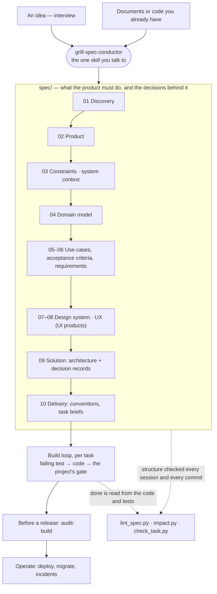

# How it works

What the system is, how you drive it, and what each background tool does.

## In one paragraph

You describe what you want to build. The system interviews you, or reads documents you already have and questions them the same way, and writes a cross-referenced specification under `spec/`. From that spec it derives what a coding agent needs: an architecture, coding conventions, a list of task briefs, and one agent guide (`AGENTS.md`). Then it drives the coding, task by task, test-first, and checks that each task is really done by reading the code and tests. Small tools check structure; the thinking — is this requirement right, is anything missing — is done by the model, through the interviews and the audits.

## The one thing to know

You talk to one skill, the conductor: `/grillspec:grill-spec-conductor` in Claude Code, `$grillspec:grill-spec-conductor` in Codex. It reads the state of the spec and offers the few sensible next moves. You never need to call the other skills yourself, though you can.

## Lean by default

An area, a file, a rule or a gate earns its place by having a reader: a later step, a tool, or a person who will act on it. What has no reader is not written. Two settings apply that principle to your project. The conductor asks for both in the first session and stores them in `.grillspec/project.json`.

### Profile — how much spec the project carries

| Profile | What is written | Choose it when |
|---|---|---|
| `lite` | problem, vision, constraints, domain model, use-cases with acceptance criteria, a few quality targets, a thin architecture, conventions, tasks | one person, or a product before launch |
| `standard` | `lite` plus goals, system context, data, security, compliance, entitlements, integration; ML requirements for an AI product; design system and UX for a product with a UI; and a short decision record for each further solution area | the product handles personal data, money or paid tiers, or has an AI capability whose quality must be gated |
| `regulated` | everything in `standard`, with the solution areas written out in full | the documents themselves are a deliverable: an auditor, a regulator or another team reads them |

The conductor recommends the smallest profile that fits and says what would justify the next one. Raising the profile later is cheap; keeping unread spec consistent is not. Five areas are optional at every profile and run only when you ask: market, customer discovery, monetization, go-to-market and growth. They are strategy documents that no coding step reads.

With no settings file, the tools assume `regulated`, so nothing is skipped by accident.

### Delivery — how work lands

| | `trunk` | `pr` |
|---|---|---|
| Where work lands | on the default branch; related slices may share a push | a short-lived branch and one pull request per task |
| Verification | local: the affected tests while iterating, the project's one gate before a push | the same local gate, then the full gate in CI on the pull request |
| CI | deploys the default branch and smokes it; every other job runs on dispatch | full gate on the pull request, merge on green, deploy on merge |
| Unattended runs | tasks one after another | tasks in parallel, one branch each |

`trunk` suits a solo project before production. `pr` suits a product with users or more than one contributor. Switching is a change to this setting and to the pipeline.

## The shape of it

## The pipeline, stage by stage

Each stage builds on the ones before it. "From" is the smallest profile that includes the skill.

| Stage | Skills | From | Produces |
|---|---|---|---|
| 01 Discovery | `grill-problem-validation` | `lite` | the problem, the riskiest bets and how to test them |
| 02 Product | `grill-product-vision` | `lite` | vision, scope, phasing (MVP, near, deferred), the go-to-market motion |
| | `grill-goals` | `standard` | success metrics and kill-criteria |
| | `grill-customer-discovery` · `grill-market` | optional | personas; competitors and sizing |
| 03 Constraints | `grill-constraints` | `lite` | technical, organisational and regulatory bounds |
| 03 System context | `grill-system-context` | `standard` | external actors, neighbouring systems, boundary interfaces (`IF-`) |
| 04 Domain | `grill-ddd` | `lite` | bounded contexts, aggregates, commands, events, invariants, the shared vocabulary |
| 05 Functional | `derive-functional` | `lite` | use-cases (`UC-`) and acceptance criteria (`AC-`) |
| 06 Requirements | `grill-quality` | `lite` | quality targets (`NFR-`, `ASR-`) |
| | `grill-data-reqs` · `grill-security-reqs` · `grill-compliance` · `grill-entitlements` · `grill-integration-reqs` | `standard` | data classes and retention (`DATA-`), threats and rules (`THR-`, `SEC-`), obligations (`OBL-`), access tiers (`ENTL-`), boundary qualities |
| | `grill-ml-reqs` | `standard`, AI products | model behaviour and evaluation targets (`ML-`) |
| 07 Design system | `grill-design-system` | `standard`, UI products | tokens, components, voice (`DS-`) |
| 08 UX | `grill-ux-reqs` | `standard`, UI products | journeys (`JRN-`), the screen inventory (`SCR-`), accessibility targets |
| 09 Solution | `derive-architecture` | `lite` | strategy, stack, the module map (`MOD-`), ADRs |
| | `derive-data-architecture` · `derive-api-contracts` · `derive-security-architecture` · `derive-observability` · `derive-infra-ops` · `derive-test-strategy` · `derive-ml-architecture` | `standard` | one decision record each; the full design at `regulated` |
| 10 Delivery | `derive-conventions` · `derive-tasks` | `lite` | coding conventions, `AGENTS.md`, the task briefs (`T-`) and their build order |
| | `derive-impl-design` | any | a short design note, written just before a `critical` task |
| 11 Commercial | `grill-monetization` · `grill-go-to-market` · `grill-growth` | optional | pricing and plans; channels and launch; experiments and analytics events |
| Build | `implement-task` · `conformance-review` · `generate-ui-prototype` | any | working code, one vertical slice at a time |
| Audit | `audit-spec` · `audit-build` | any | a report on the spec; a pre-release report on the build |
| Operate | `deploy-release` · `migrate-data` | any | deploys and data migrations, with their records |

At any stage, a question only running code can answer (is this feasible, does this flow work) is settled with a throwaway spike: the least code that answers it, after which the answer is recorded and the spike deleted.

## Decisions in the spec, descriptions in the code

The seven solution areas after the architecture are where a spec most easily grows text nobody reads, so they follow one rule: the spec holds decisions, and the artifact that enforces a design describes it.

A decision is something the code cannot tell you and that is costly to reverse: which datastore and how tenants are isolated, how an API is versioned, who authenticates users and how keys are held, which objectives page someone, the environments and the promotion path, the test tiers and their bars, what a model must pass before promotion. It is written once, as a short table or an ADR.

A description is detailed design that an executable artifact states better: table definitions live in the schema and its migrations, endpoint shapes in the contract package, the control register in the authorization code and its tests, runbooks in the alert configuration, pipeline detail in the workflows.

| Profile | The seven areas |
|---|---|
| `lite` | not written; their few decisions are rows in the architecture's solution strategy and the conventions |
| `standard` | decision mode: each area writes only its decision record, for example the tier contract in `test/levels.md` or the environments in `infra-ops/environments.md` |
| `regulated` | full mode: the complete design, because the document is itself something people outside the build read |

## Two ways in

- **From an idea.** The conductor interviews you area by area. A vague answer becomes a measurable bar, and edges, errors and states are worked out before an area is called consistent.
- **From what you already have.** Documents are questioned, not filed: a document that reads cleanly can still be silent on a whole case, and a confident sentence can be an untested assumption. Each gap, vague claim and contradiction is recorded in the artifact it belongs to. Existing code is reverse-read into a partial spec, with every unknown recorded as a gap. In both cases, content with no reader — change history, status notes, prose that restates code — is left behind.

## From scratch, and ongoing work

The system is used in two different ways, and the second uses far less of it.

**From scratch**, the conductor walks the in-profile areas in order, then the build order task by task.

**Ongoing work** is the normal mode once a product exists. A change is sized by tier: a `routine` change goes straight to code with a failing test; a `feature` change amends the acceptance criteria and any rule it alters, gets one brief, and is built; a `critical` change adds a design note and an independent review. Only the areas a change reaches are opened, and most skills stay unused for long stretches — an interview skill runs when a change needs a fact the spec does not hold, not on a schedule.

A project that already has code is **adopted** once. One built without this system gets only what its code cannot tell a reader. One built with an earlier major version runs `migrate_project.py`, which carries task status into the briefs, removes the old ledger and locks, vendors the current tools, and lists what is left to prune.

## Changing the spec

Every file under `spec/` is an ordinary authored document that states what is true now. The skill that owns an area edits its files in place, making the smallest change in meaning and rewriting the affected passage so the file still reads as written in one pass. A problem found while coding is fixed in the area that owns the fact, in the same session as the code, so the two never disagree.

The spec's stable IDs form a reference graph. `impact.py` walks it: given the IDs that changed, it lists every spec file, task and test that depends on them, upstream first. That list is re-worked, and nothing else is. Git holds the history; the spec files do not narrate their own changes, and the linter enforces that.

## Tasks, tiers and done

A task is one brief, `spec/10-delivery/tasks/T-NNN.md`: a single table that says what the slice delivers, the acceptance criteria with their text, what it touches, the rules that bind it, and what it deliberately leaves out. An agent can build from the brief and the code without looking anything else up.

Each brief carries a risk tier, and the tier decides how much process the work owes:

| Tier | What it is | What it owes |
|---|---|---|
| `routine` | a bug fix, a copy or visual tweak, a refactor, a dependency bump | no brief: a failing test first, the fix, the project's gate |
| `feature` | new behaviour inside an existing module | the brief, test-first, the gate |
| `critical` | a new aggregate or context, a schema or data migration, an authentication, authorization, erasure or billing path, a model seam, any one-way door | the brief, a short design note before coding, the gate, and one review by a reviewer that did not write the code |

Building is test-first, one behaviour at a time: a failing test, the smallest real code that passes it, then the next. Tests are tagged with what they prove — `@covers AC-101a` for an acceptance criterion, `@state:empty` for a UI state.

Those tags are how done is decided. There is no completion record to fill in. `check_task.py` reads the tree and reports, for every task, which criteria have a covering test; a task marked `done` whose criteria are not all covered, or whose `critical` review is missing, fails the check. The only progress that is stored is the `status` row in the brief. Whether the tests pass, and the coverage and mutation bars, are enforced by the project's own gate through its test-runner configuration.

Production code is real from the first line. A stub or a canned response makes tests pass against a system that does nothing, so test doubles live only under the test tree, and a dependency that is not available yet leaves its test failing until it is.

## The tools

All are small scripts with no dependencies beyond Python (one needs PyYAML). [SPEC-CHECKS.md](SPEC-CHECKS.md) lists every check they make.

| Tool | Job | Runs |
|---|---|---|
| `project_config.py` | prints or sets the profile and delivery mode | first session; read by other tools |
| `migrate_project.py` | brings a project built with an earlier major version onto the current layout | once, at adoption |
| `lint_spec.py` | structure of the spec: paths, headers, IDs and references, coverage, task briefs, the profile, timeless wording | every conductor session; every commit |
| `impact.py` | what depends on a changed ID | whenever the spec changes |
| `spec_status.py` | counts and mechanical blockers; it does not judge content | on demand |
| `check_contracts.py` | IDs in OpenAPI and AsyncAPI files resolve | every commit, where contracts exist |
| `check_task.py` | task status, done-claims, and the criterion-to-test trace, from the tree | at done; every commit; on demand |
| `gate_exec.py` | the edit hook: denies an edit that adds a skipped test or a fake in production code | as each edit is made |
| nine `check_*.py` checkers | no fakes, no skipped tests, no tests without a spec driver, mock limits per tier, tiers present, e2e against a real environment, config declared, a real deploy, real migrations | in the project's gate and the release audit |

Two hooks are installed into your repository, and none anywhere else. The git pre-commit hook runs the linter, the contract check, the done-claim check and the orphan-test check. The edit hook runs inside Claude Code and Codex. Both can be overridden in an emergency (`git commit --no-verify`, `GRILLSPEC_GATE_OFF=1`).

Project gates start as a small core — module boundaries, no fakes, no skipped tests, config drift — and grow when an incident shows a rule was needed.

## Tools check structure; people and the model check meaning

The tools cannot tell you whether a requirement is correct, whether a document is complete, or whether two sentences mean the same thing. That is the work of the interviews, of `audit-spec` (the whole spec: contradictions, missing branches, content with no reader, whether an agent could build from it) and of `audit-build` (the whole build before a release). A clean linter run on a spec nobody questioned proves little; both layers are needed.

## Where things live

| Path | Holds |
|---|---|
| `spec/` | the specification, in numbered stage folders `01-discovery` … `12-operate` |
| `spec/adr/` | every architecture decision record, one file each, named `ADR-<AREA>-NNN.md` |
| `spec/_human-input.md` | the one queue of things only you can supply: values to confirm, blockers to clear |
| `spec/_provisioning.md` | the credentials the build needs, and whether each is provisioned |
| `spec/12-operate/` | dated records of what happened to the running system, and `bootstrap.md`, the setup runbook |
| `AGENTS.md` · `CLAUDE.md` | the one agent guide; `CLAUDE.md` contains exactly `@AGENTS.md` |
| `.grillspec/` | `project.json`, the vendored tools, hook configuration, waivers |
| `src/` · `tests/` | code and tests, and nothing else |

There are no side ledgers. An open point is resolved in its artifact, or deferred there with the trigger that reopens it; a deliberate, costly-to-reverse choice becomes an ADR. Bets and risks sit beside what they affect, each with a status. Each area keeps its own glossary and actor list, and the conductor reconciles a system-wide view.

Behind the skills are three shared method files — `grill-engine.md` for interviews, `derive-engine.md` for derivations, `exec-engine.md` for building — plus `house-rules.md` (the rules every artifact follows) and `decision-classes.md` (what the system decides itself and what it asks you). Each rule is stated once there.

## Driving it

1. Run the conductor. It reports where the spec stands and recommends a next move.
2. Answer its questions, or confirm the default it proposes. It decides what engineering merit settles and asks only for facts that you, your organisation or your platform hold.
3. When the spec is ready for the profile, it derives conventions and tasks and drives the build, one task at a time.
4. Asked to, it runs that loop across every ready task on its own and stops only where a person is needed: a visual or product decision, a legal sign-off, a credential. Those asks are collected in `spec/_human-input.md` so you can clear them in one sitting.
5. Before a release, `audit-build` checks the whole build. At `lite` and `standard` that is a short check; at `regulated` it is the full attestation.
