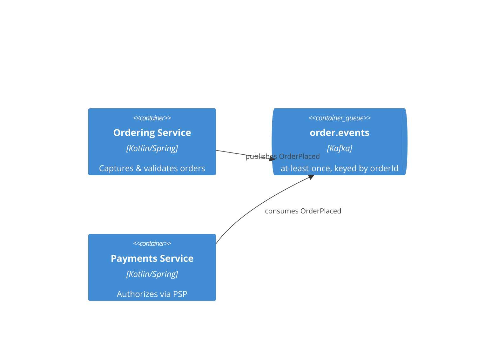

# derive-architecture — worked example

Illustrative: it shows the shape, not required content.

Upstream: "order capture must stay up if Payments is down" → `ASR-003` (availability of the capture path); contexts Ordering, Payments and Inventory from the domain model.

## At every profile

A fork decided on merit, not asked (`solution-strategy.md`):

> 2. Ordering → Payments is asynchronous. Capture must survive a Payments outage, and a synchronous call would couple their availability. Rejected: synchronous call with a circuit breaker. → `ADR-ARCH-004`

The ADR's consequence records the residual risk: at-least-once delivery can double-charge, mitigated by an idempotent consumer keyed on `orderId`.

Module map (`modules.md`) — the seam contracts slices integrate against; internals are left to per-slice design:

| Module | Role | Realises | Direction | Seam interface |
|---|---|---|---|---|
| MOD-010 Ordering | domain | `AGG-Order` · `UC-014` | inward only | `placeOrder(cmd) → OrderId` · emits `OrderPlaced` |
| MOD-020 PaymentsGateway | driven-port | `AGG-Order` (authorize step) | the domain depends on the port | `authorize(orderId, amount) → AuthResult` |
| MOD-030 OrderEventsPublisher | adapter | N/A — event transport | implements a driven port | publishes to `order.events`, keyed by `orderId` |

## From `standard`

C4 container slice (`c4.md`):

ASR → tactic → location → fitness function (`quality.md`):

| ASR | Tactic | C4 location | Fitness function |
|---|---|---|---|
| ASR-003 | bulkhead + async hand-off | Ordering → `order.events` → Payments | chaos test stops Payments; capture p99 stays under 300 ms with no dropped order |

Key sequence (`sequences.md`), the critical-failure path: Payments is down at capture time → the order is still placed, `OrderPlaced` is queued, and authorization is retried on recovery, idempotent by `orderId`.
