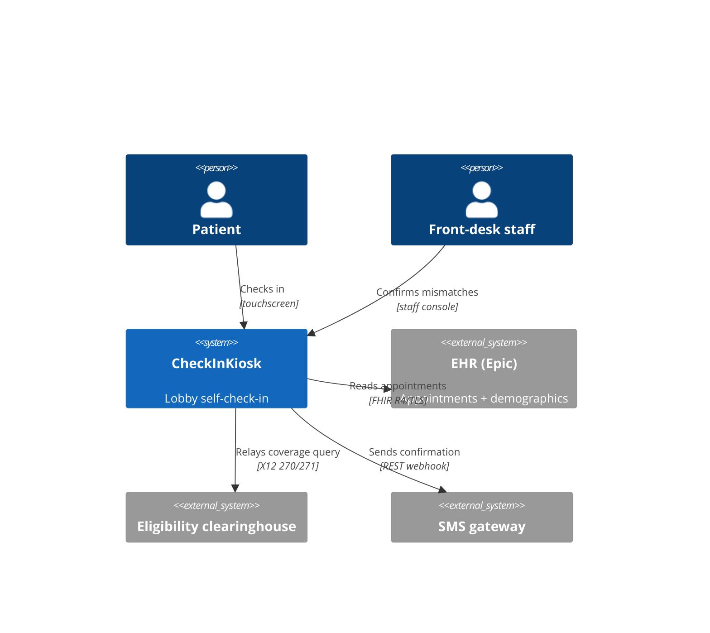

# grill-system-context — worked example

Illustrative: it shows the shape of the output, not a list to fill. The system is a clinic's patient check-in kiosk, before any internals are drawn.

> **Agent:** When the kiosk verifies a patient's insurance, does our system decide eligibility, or does it relay an answer from the payer's clearinghouse? *(I'd put eligibility outside the boundary: we ask, they rule.)*
> **User:** We relay. The clearinghouse rules; we show the result.
> **Agent:** Then the clearinghouse is a neighbor. Does the kiosk ever write to the EHR, or only read appointments from it?
> **User:** Read-only on appointments. Demographic edits go to the EHR, but a staff member confirms them, not the kiosk.

## Output — `scope.md`
**System:** CheckInKiosk · **Purpose:** let an arriving patient confirm identity, appointment and coverage at a lobby terminal.
- **IN:** identity match · appointment lookup · coverage-check relay · queue-position assignment
- **OUT:** eligibility adjudication (the payer owns it) · demographic writes to the patient record · clinical content · payment capture

## Output — `actors.md`
| Actor | Type | Role at boundary |
|---|---|---|
| Patient | human | checks in at the terminal |
| Front-desk staff | human | confirms flagged demographic mismatches |
| EHR (Epic) | system | source of appointments and demographics (read) |
| Eligibility clearinghouse | system | rules on coverage; the kiosk relays |
| SMS gateway | system | sends the check-in confirmation |

## Output — `interfaces.md`
| Interface | Neighbor | Direction | What flows (business) | Channel (technical) | Trigger |
|---|---|---|---|---|---|
| IF-001 | EHR (Epic) | in | today's appointments, patient demographics | FHIR R4 REST | patient enters date of birth and last name |
| IF-002 | Clearinghouse | bi | coverage query → eligibility answer | X12 270/271 through the vendor API | identity matched |
| IF-003 | SMS gateway | out | check-in confirmation | REST webhook | queue position assigned |

## Output — `context-diagram.md`

The user never heard the words "C4" or "black box"; the questions stayed in their terms.
